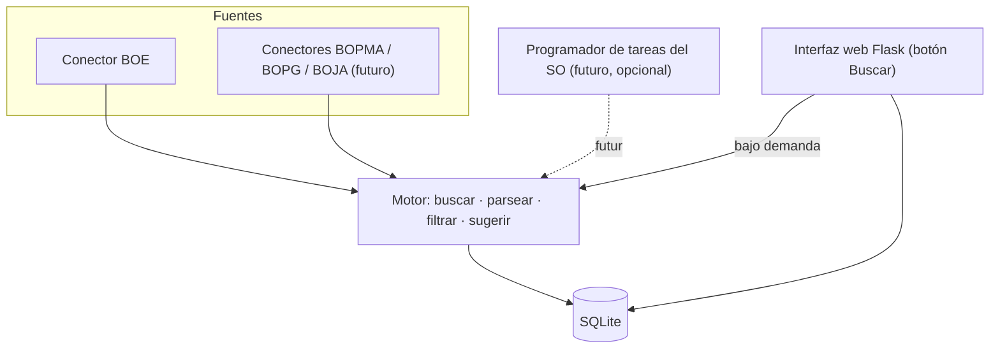
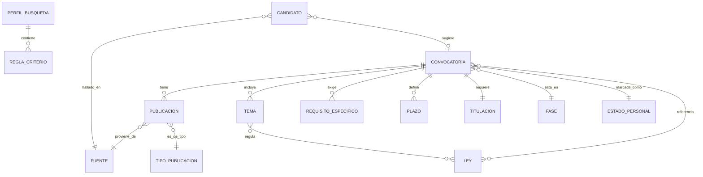

# OpoTrack — Documento de Especificación

**Versión:** 1.1 (revisión de diseño)
**Fecha:** 6 de agosto de 2026
**Estado:** Definición en curso; fuente BOE validada técnicamente

> **Cambios en la v1.1** (a partir de la revisión de diseño): la búsqueda pasa a ser **bajo demanda** como mecanismo principal (la automática se explica como opción futura); se precisa el **ámbito geográfico** (Granada/Málaga en ambas ramas, resto solo informática); el borrado va a una **papelera** reversible; los criterios son **configuración persistente**; se añade la entidad **Ley** enlazable a temas y convocatorias; la **bandeja** guarda la fecha de entrada y resalta lo atrasado; y se definen **límites del botón de búsqueda**.

---

## 1. Objetivo

OpoTrack es una aplicación web de uso local para **buscar y hacer seguimiento de convocatorias de oposiciones** publicadas en boletines oficiales. Automatiza la parte tediosa —revisar boletines en busca de convocatorias que encajen con unos criterios— y deja en manos del usuario la decisión de qué seguir, cómo agruparlo y cuándo descartarlo. El seguimiento cubre todo el ciclo de vida de cada oposición, desde la publicación de las bases hasta la resolución final, con especial atención a las **fechas y plazos** y a la **base jurídica** (leyes) de cada temario.

El principio rector de todo el sistema es **el usuario tiene siempre la última palabra**: el sistema propone (qué encaja con los criterios, con qué convocatoria se asocia una publicación, en qué fase está), y el usuario confirma, corrige o descarta.

---

## 2. Alcance

### 2.1 Dentro del MVP

- Búsqueda en el **BOE** (fuente de datos abiertos).
- Criterios de búsqueda **configurables y persistentes** (perfiles guardados, editables en cualquier momento).
- Búsqueda **bajo demanda** (el usuario pulsa un botón), con límites de uso.
- **Bandeja de novedades** pendientes de revisar, persistente entre días, con aviso en la propia web.
- Alta de convocatorias en seguimiento con **confirmación manual** por el usuario.
- Asociación de nuevas publicaciones a convocatorias existentes (sugerida por el sistema, confirmada por el usuario).
- Módulo de **seguimiento**: ficha completa, fase actual, historial de publicaciones, temario, requisitos y plazos.
- **Entidad Ley** enlazable a los temas del temario.
- **Borrado a papelera** (reversible) de convocatorias.

### 2.2 Fuera del MVP (ampliaciones previstas)

- **Búsqueda diaria automática** (sin abrir la app), mediante el Programador de tareas del sistema.
- Conectores para **BOPMA** (Málaga), **BOPG** (Granada) y **BOJA** (Junta de Andalucía).
- **Autocomprobación de titulación** contra los títulos del usuario.
- **Cálculo automático del fin de plazo** en días hábiles con calendario de festivos.
- **Enlace automático ley–tema** (detección de leyes citadas en el temario).
- Notificaciones por **email** o de **escritorio**; exportación de fichas e informes.

---

## 3. Perfil de usuario y ámbito de interés

Usuario único, uso personal. Interesado inicialmente en los grupos **C1, C2 y B** (funcionario) y **M2, M1 y E2** (personal laboral). Estos intereses cambiarán con el tiempo, por lo que **todos los criterios de búsqueda son configurables** desde la aplicación, sin tocar código.

**Ámbito geográfico y ramas (regla de interés):**

- **Granada y Málaga** (prioridad principal): interesan **ambas ramas**, administrativa **e** informática.
- **Resto de Andalucía y resto de España**: **solo informática**.

Dicho de otro modo: la rama **administrativa** se limita, en principio, a **Granada y Málaga**; la rama **informática** interesa **en cualquier ámbito**.

> **Matiz importante de cobertura:** aunque la fuente técnica del MVP es el BOE (de alcance estatal), el interés geográfico es sobre todo **andaluz y local**. El grueso de las convocatorias locales de Granada y Málaga se publica en sus boletines provinciales, no en el BOE. Por tanto, con solo el BOE se captará bien la parte **estatal de informática** y el **personal laboral de la AGE**, además de los **extractos** de convocatorias autonómicas/locales; la cobertura plena de Granada y Málaga llegará con los conectores **BOPMA, BOPG y BOJA**.

---

## 4. Decisiones de diseño acordadas

| Aspecto | Decisión |
|---|---|
| Tipo de aplicación | Web local (navegador contra `localhost`) |
| Ejecución de la búsqueda | **Bajo demanda** (botón). La diaria automática queda como ampliación futura |
| Límite del botón de búsqueda | Máximo configurable de búsquedas/día (10 al inicio → 3 en régimen); detección de "BOE aún no publicado"; idempotente |
| Fuente en el MVP | Solo BOE; el resto como conectores posteriores |
| Aviso de novedades | En la propia web (contador / bandeja) |
| Criterio del filtro | Exhaustivo ("no perderme nada") |
| Criterios de búsqueda | Configuración **persistente**, editable en cualquier momento (no se define al vuelo) |
| Ámbito × rama | Granada/Málaga → admin + informática; resto → solo informática |
| Alta en seguimiento | Manual, confirmada por el usuario |
| Asociación de publicaciones | Sugerida por el sistema, confirmada por el usuario |
| Fase de la convocatoria | Híbrida: propuesta automática + confirmación |
| Temario | Lista de temas con estado de estudio, enlazables a leyes |
| Titulación | Se guarda la exigida (incl. texto literal); autocomprobación aplazada |
| Borrado | A **papelera** reversible, no definitivo |

---

## 5. Arquitectura general

El sistema se separa en componentes con responsabilidades bien delimitadas, de modo que la lógica no dependa de la fuente ni de la interfaz:

- **Motor (núcleo):** lógica de búsqueda, descarga, parseo, normalización, filtrado por criterios y sugerencia de coincidencias. Es independiente de la interfaz y se puede invocar de dos maneras: desde la web (cuando el usuario pulsa "buscar") y como **script de línea de comandos** (base para una futura ejecución automática). Así no se duplica lógica.
- **Conectores de fuentes:** un adaptador por boletín, todos con la **misma interfaz** (dado un día o rango de fechas, devolver los anuncios normalizados). El núcleo no conoce los detalles de cada boletín. En el MVP solo existe el conector BOE; añadir uno nuevo no toca el núcleo.
- **Persistencia:** base de datos **SQLite** a través de **SQLAlchemy**.
- **Interfaz web:** **Flask** con plantillas **Jinja2**, servida en local.

> **Sobre la ejecución automática (respuesta a la duda planteada).** Una app web local solo se ejecuta cuando está abierta. Para que la búsqueda ocurra "sola" sin la app abierta hay dos vías: (a) tener un proceso corriendo permanentemente en segundo plano —consume recursos y hay que mantenerlo vivo—; o (b) que el **Programador de tareas de Windows** lance a una hora un pequeño script (el mismo motor) que busca, guarda en la base de datos y se cierra —**no requiere la app abierta, solo que el ordenador esté encendido a esa hora**—. Al abrir después la web, las novedades ya están cargadas. Por sencillez y control, el **MVP usa solo búsqueda bajo demanda**; la vía (b) queda documentada como ampliación futura opcional.

---

## 6. Fuentes de datos

### BOE (MVP) — validado el 6 de agosto de 2026

Publica un **sumario diario** a través de una **API REST de datos abiertos** oficial y gratuita, con reutilización legalmente prevista. Cada anuncio tiene un **identificador oficial único** (por ejemplo `BOE-A-2026-14786`), lo que permite deduplicar de forma fiable.

**Acceso confirmado:**

- Endpoint: `GET https://www.boe.es/datosabiertos/api/boe/sumario/{AAAAMMDD}`
- **Requiere** la cabecera `Accept: application/json` (o `application/xml`); sin ella la petición falla. Se usará **JSON**.
- **Disponibilidad diaria:** no hay hora fija garantizada; habitualmente entre las **6:00 y las 8:30**, con posibles retrasos los días de gran volumen (el RD 181/2008 no fija hora exacta). Si se pide el sumario de un día aún no publicado, la API responde **404**, lo que el sistema usa para avisar "el BOE de hoy aún no está disponible".

**Estructura de la respuesta:** `sumario → diario → seccion → departamento → epigrafe → item`. Cada **sección** tiene un `codigo`; las oposiciones son la **sección `2B`** ("II. Autoridades y personal — B. Oposiciones y concursos"). La `2A` ("Nombramientos, situaciones e incidencias") es útil más adelante.

**Campos de cada `item`:**

| Campo del BOE | Uso en OpoTrack |
|---|---|
| `identificador` (p. ej. `BOE-A-2026-14786`) | `referencia_oficial` de Publicación; clave de deduplicación |
| `titulo` (hasta 4000 car., descriptivo) | Texto sobre el que aplican las reglas de filtrado; de él se extraen cuerpo, grupo y nº de plazas |
| `departamento` (nombre y código) | Organismo convocante |
| `fecha_publicacion` del sumario | Fecha de la publicación / fecha base BOE |
| `url_pdf` / `url_html` / `url_xml` | PDF a archivar / texto a mostrar / versión estructurada |

**Ejemplo real comprobado** — `BOE-A-2026-14786`: *"…proceso selectivo para ingreso… como personal laboral fijo, en los grupos profesionales M3, M2, M1, E2 y E1…"*. Confirma que los grupos y el tipo de personal aparecen **literalmente en el título**, por lo que el filtrado por reglas de texto es viable.

**Legislación consolidada (para la entidad Ley):** la misma API ofrece `/datosabiertos/api/legislacion-consolidada`, que permite obtener datos y la **URL consolidada** de una norma. Es la vía natural para nutrir la entidad Ley (ver §9).

### BOPMA / BOPG (futuro)

Boletines provinciales de Málaga y Granada. Normalmente publican en **PDF**, con poca estructura. Requerirán *scraping* y extracción de texto de PDF. Son la clave para cubrir el ámbito local andaluz.

### BOJA (futuro)

Boletín Oficial de la Junta de Andalucía; relevante para las oposiciones autonómicas andaluzas.

Cada fuente se implementa como un conector independiente que cumple la interfaz común.

---

## 7. Flujo funcional

### 7.1 Búsqueda (bajo demanda)

El usuario abre la app y pulsa **Buscar**. El motor descarga el sumario del día (o del rango pendiente desde la última búsqueda), aplica los criterios persistentes activos y produce una lista de **candidatos**. La acción está sujeta a los **límites del botón** (§12): un máximo de búsquedas al día y la detección de que el BOE aún no está publicado. Como el identificador del BOE es único, repetir la búsqueda del mismo día **no genera duplicados**.

### 7.2 Bandeja de novedades

Los candidatos **no entran directamente** en el seguimiento: quedan en una **bandeja de pendientes de revisar**, que es **persistente**: lo que entra en ella **no sale sin acción expresa del usuario**, y lo no revisado un día **permanece** al día siguiente. Cada entrada guarda su **fecha de entrada en la bandeja**. La bandeja se ordena por **nivel de confianza**, y las entradas de **días anteriores al actual** se **resaltan** (color de fuente / marca de "atrasada") para que se distingan de las de hoy. Para cada candidato el usuario puede:

- Crear una **convocatoria nueva** en seguimiento.
- **Asociarlo** a una convocatoria existente.
- **Descartarlo** (el descarte se recuerda para no volver a mostrar el mismo anuncio).

### 7.3 Confirmación y asociación (deduplicación)

Una oposición genera muchas publicaciones a lo largo del tiempo —bases, apertura de plazo, listas de admitidos, fecha de examen, resultados, bolsa…— a veces en boletines distintos. El sistema **sugiere** a qué convocatoria existente pertenece un anuncio (usando organismo + cuerpo/plaza + año) y el usuario confirma o corrige. Cada anuncio se guarda como una **Publicación** ligada a su **Convocatoria**.

### 7.4 Seguimiento

Para cada convocatoria, el usuario ve: la ficha con todos los detalles (cuerpo, puesto, grupo, rama, localidad, requisitos, titulación, temario), la **línea temporal** de publicaciones, la **fase actual**, los **plazos**, su **estado personal** y las **leyes** enlazadas a cada tema.

### 7.5 Borrado a papelera (reversible)

El borrado **no es definitivo**. Al eliminar una convocatoria, esta pasa a una **papelera / historial de eliminados**, conservando todo su contenido. Desde la papelera el usuario puede **restaurarla** o **borrarla definitivamente**. Así, quitar algo de la vista de seguimiento nunca implica perder datos por accidente.

---

## 8. Criterios de búsqueda configurables (persistentes)

Los criterios **no se definen en el momento de buscar**, sino que son **datos guardados** que el usuario administra en una sección de **Configuración de búsqueda**: son **persistentes** y **modificables en cualquier momento**. La búsqueda simplemente aplica los perfiles que estén activos.

El dato "grupo C1" o "rama informática" **no viene como campo limpio** en el boletín, sino embebido en el **texto** del anuncio. Por eso los criterios se definen como **reglas de coincidencia de texto**, agrupadas en **perfiles de interés**. Cada perfil contiene:

- **Términos de inclusión** y **de exclusión**.
- **Rama** asociada (administrativa / informática).
- **Ámbito geográfico** (p. ej. Granada, Málaga, resto de Andalucía, resto de España).

La combinación ámbito × rama traduce la regla del §3 en perfiles concretos, por ejemplo:

- *Granada/Málaga — Administrativo*
- *Granada/Málaga — Informática*
- *Informática — resto de España/Andalucía*

Mientras la fuente sea el BOE, el filtro **geográfico** se resuelve por texto (provincia/municipio en el título o el departamento). El filtro opera en **modo exhaustivo**: ante la duda, muestra; el usuario descarta en la bandeja lo que no valga.

---

## 9. Modelo de datos

### 9.1 Entidades núcleo

**Convocatoria** — el "hilo" que representa una oposición y agrupa todas sus publicaciones.

| Campo | Descripción |
|---|---|
| id | Identificador interno |
| organismo | Organismo convocante |
| ambito | Estatal / autonómico / provincial / local |
| provincia / localidad | Localización |
| cuerpo_escala | Cuerpo o escala |
| puesto | Denominación de la plaza/puesto |
| grupo | C1, C2, B, M1, M2, E2… |
| rama | Administrativa, informática, … |
| tipo_personal | Funcionario / laboral |
| sistema_acceso | Oposición / concurso-oposición / concurso |
| num_plazas | Número de plazas |
| fase_actual | Referencia al catálogo de Fases |
| estado_personal | Referencia al catálogo de Estados personales |
| estado_registro | **activa / en_papelera** (borrado reversible) |
| fecha_eliminacion / motivo_eliminacion | Datos de la papelera (si aplica) |
| fecha_base_boe | Fecha de publicación en BOE de referencia para plazos |
| notas | Observaciones |
| fecha_alta / fecha_actualizacion | Auditoría |

**Publicación** — cada anuncio individual referido a una convocatoria.

| Campo | Descripción |
|---|---|
| id | Identificador interno |
| convocatoria_id | Convocatoria a la que pertenece |
| fuente_id | Boletín de origen (BOE, BOPMA, BOPG, BOJA) |
| referencia_oficial | Identificador oficial (p. ej. `BOE-A-2026-14786`); único por fuente, para deduplicar |
| tipo_publicacion | Referencia al catálogo de Tipos de publicación |
| fecha_publicacion | Fecha de publicación en el boletín |
| titulo | Título / sumario del anuncio |
| url / ruta_pdf | Enlace al anuncio y copia local del PDF |
| resumen | Resumen u observaciones |
| fecha_deteccion | Cuándo lo encontró OpoTrack |

**Tema** — un tema del temario de una convocatoria.

| Campo | Descripción |
|---|---|
| id | Identificador interno |
| convocatoria_id | Convocatoria a la que pertenece |
| bloque | Parte del temario (general / específica u otra) |
| numero | Número de tema |
| titulo | Enunciado del tema |
| estado_estudio | Pendiente / en curso / estudiado / a repasar |
| notas | Observaciones |

**Plazo** — fechas con inicio y fin: `id`, `convocatoria_id`, `tipo_plazo` (solicitud, subsanación, alegaciones, recurso…), `fecha_inicio`, `fecha_fin`, `publicacion_origen_id`, `notas`.

**Titulacion** — titulación exigida: `id`, `convocatoria_id`, `nivel_academico`, `titulos_admitidos`, `admite_equivalentes`, `texto_literal` (el requisito tal cual), y `cumple_usuario` *(previsto, sin usar en el MVP)*.

**RequisitoEspecifico** — requisitos propios de la convocatoria: `id`, `convocatoria_id`, `descripcion`, `notas`.

### 9.2 Entidad Ley y sus enlaces (base jurídica)

**Ley** — norma jurídica, **global** (existe una sola vez y se reutiliza en todos los temas/convocatorias que la citen).

| Campo | Descripción |
|---|---|
| id | Identificador interno |
| denominacion | Nombre completo (p. ej. "Ley 39/2015, de 1 de octubre, del Procedimiento Administrativo Común…") |
| tipo_rango | Ley orgánica, ley, real decreto, decreto legislativo… |
| numero / anio | Número y año de la norma |
| fecha | Fecha de la norma |
| identificador_boe | Identificador BOE de la norma (p. ej. `BOE-A-2015-10565`) |
| url_consolidada | **URL a la publicación consolidada** en el BOE |
| ambito | Estatal / autonómico… |
| vigente | Sí / No |
| fecha_actualizacion_consolidada | Última actualización del texto consolidado |
| notas | Observaciones |

**Enlaces (N:M):** una ley puede estar ligada a **varios temas** y a **varias convocatorias**, y un tema puede citar **varias leyes**:

- **Tema ↔ Ley** (tabla de enlace `tema_ley`): es el vínculo principal, para los temas jurídicos del temario.
- **Convocatoria ↔ Ley** (tabla de enlace `convocatoria_ley`): opcional, para leyes relevantes a nivel de convocatoria que no cuelguen de un tema concreto.

**Cómo se crea el enlace:** en el MVP, **manualmente** desde la ficha, idealmente **arrastrando y soltando** una ley sobre un tema. Como ampliación futura, un **enlace automático** que detecte en el enunciado del tema referencias tipo "Ley 39/2015" y las case con el catálogo de leyes (apoyándose en la API de legislación consolidada del BOE para dar de alta la norma y su URL consolidada).

### 9.3 Configuración de búsqueda (persistente)

**PerfilBusqueda:** `id`, `nombre`, `activo`, `rama`, `ambito_geografico`, `fuentes`.
**ReglaCriterio:** `id`, `perfil_id`, `tipo` (inclusión / exclusión), `termino`.

### 9.4 Bandeja y memoria de descartes

**Candidato** (bandeja de novedades): `id`, `fuente_id`, `referencia_oficial`, `fecha_publicacion`, `titulo`, `url`, `perfil_coincidente`, `nivel_confianza`, **`fecha_entrada_bandeja`**, `estado` (pendiente / aceptado / descartado), `convocatoria_sugerida_id`. La entrada permanece hasta que el usuario actúe; `fecha_entrada_bandeja` permite ordenar y **resaltar las atrasadas**.

**Descarte** (memoria): `id`, `referencia_oficial`, `fecha_descarte`, `motivo`. Evita volver a mostrar un anuncio ya descartado.

### 9.5 Catálogo de tipos de publicación

Convocatoria/bases · corrección de errores · apertura de plazo · lista provisional de admitidos · lista definitiva de admitidos · designación del tribunal · fecha y lugar de examen · resultados de un ejercicio · resultados provisionales · resultados definitivos · fase de concurso (méritos) · nombramiento/adjudicación · bolsa de trabajo · otros.

### 9.6 Catálogo de fases

Convocada → plazo de solicitudes abierto → plazo cerrado → admitidos (provisional) → admitidos (definitiva) → en examen → resultados provisionales → resultados definitivos → concurso de méritos → nombramiento / bolsa → finalizada.

### 9.7 Estados personales

Me interesa · inscrito · preparando · en espera · descartada.

### 9.8 Diagrama entidad-relación

*(El borrado a papelera se modela con `estado_registro` en Convocatoria, no como entidad aparte; si se prefiere, puede implementarse como tabla independiente de "eliminados".)*

---

## 10. Fechas y plazos

- Se registra la **fecha de publicación** de cada anuncio.
- La **fecha de publicación en el BOE** se marca como referencia (`fecha_base_boe`), por ser la base habitual del cómputo del plazo de solicitudes.
- Los plazos se guardan con **tipo, inicio y fin**, vinculables a la publicación que los origina.
- **Alertas:** panel de "plazos que vencen pronto" en la web.
- *(Futuro)* **Cálculo automático del fin de plazo:** en torno a 20 días hábiles desde el día siguiente a la publicación, descontando festivos nacionales, autonómicos y locales (requiere calendario de festivos), por eso se aplaza.

---

## 11. Interfaz web

Pantallas principales:

- **Panel / inicio:** novedades pendientes (con contador) y plazos próximos a vencer.
- **Bandeja de novedades:** candidatos ordenados por confianza, mostrando la **fecha de entrada** y **resaltando en color las entradas atrasadas** (de días anteriores); acciones aceptar / asociar / descartar.
- **Listado de convocatorias:** las que están en seguimiento, con filtros (grupo, rama, ámbito, fase, estado personal).
- **Ficha de convocatoria:** pestañas de detalles, publicaciones (línea temporal), **temario** (con progreso y **leyes enlazadas por arrastrar y soltar**), requisitos, plazos.
- **Leyes:** catálogo de normas con su enlace a la versión consolidada del BOE.
- **Papelera:** convocatorias eliminadas, con opciones de restaurar o borrar definitivamente.
- **Configuración de búsqueda:** perfiles (rama + ámbito + reglas), fuentes activas, límite del botón y datos del usuario.

---

## 12. Búsqueda: ejecución y límites

### 12.1 Modo de ejecución

**Bajo demanda:** el usuario pulsa **Buscar** con la app abierta. Es el único modo en el MVP.

**Automática (futuro, opcional):** un script (el mismo motor) lanzado por el **Programador de tareas de Windows** a una hora fija, que busca y guarda sin la app abierta (solo requiere el equipo encendido). Al abrir la web, las novedades ya están cargadas.

### 12.2 Límites del botón de búsqueda

Como el BOE **no tiene hora fija** de publicación (habitualmente 6:00–8:30, con posibles retrasos), en lugar de una ventana horaria rígida se combinan:

- **Máximo de búsquedas por día**, configurable: **10** durante la puesta a punto, **3** en régimen normal.
- **Detección de "aún no publicado":** si la API devuelve 404 para el día, se avisa y no se consume intento (o se avisa de reintentar más tarde).
- **Idempotencia:** al ser único el identificador del BOE, repetir la búsqueda de un día no duplica nada; con **una** búsqueda diaria basta para nutrir OpoTrack.
- **Aviso orientativo:** la interfaz puede indicar "el BOE suele estar disponible a partir de las 8:30".

Este esquema respeta el uso responsable del servicio sin depender de una hora exacta.

---

## 13. Stack tecnológico

| Componente | Tecnología |
|---|---|
| Lenguaje | Python 3.11+ |
| Interfaz web | Flask + Jinja2 |
| Persistencia | SQLite + SQLAlchemy (migrable a PostgreSQL si crece) |
| Parseo BOE | JSON de la API de datos abiertos (respaldo XML con lxml) |
| Descargas HTTP | httpx o requests (con cabecera `Accept`) |
| Extracción PDF (BOP, futuro) | pdfplumber / PyMuPDF |
| Planificación (solo búsqueda automática futura) | Programador de tareas del SO (o APScheduler) |
| Migraciones de esquema | Alembic (opcional) |

---

## 14. Roadmap por fases

1. **Validación técnica del BOE** — ✅ *hecha (6-ago-2026)*: endpoint, cabecera `Accept`, formato JSON y sección `2B` confirmados. Detalles en §6.
2. **Núcleo + base de datos:** modelo de datos (incluida la entidad Ley) y motor con el conector BOE, probado por línea de comandos.
3. **Interfaz web:** botón Buscar con límites, bandeja de novedades (con fechas y resaltado), alta y asociación, listado y ficha de seguimiento, papelera.
4. **Base jurídica y plazos:** gestión de leyes y enlace ley–tema (arrastrar y soltar); alertas de plazos.
5. **Conectores adicionales:** BOPMA, BOPG y BOJA (cobertura del ámbito andaluz).
6. **Ampliaciones:** búsqueda diaria automática, autocomprobación de titulación, cálculo de plazos en días hábiles, enlace automático ley–tema, exportación y notificaciones.

---

## 15. Riesgos y cuestiones abiertas

- **Cobertura local con solo BOE:** el interés principal (Granada/Málaga) es local y el BOE no lo cubre por completo; la cobertura plena depende de los conectores BOPMA/BOPG/BOJA (fase 5).
- **Uso responsable del BOE:** sin hora fija de publicación; se mitiga con el límite de búsquedas/día, la detección de 404 y la idempotencia (§12). Basta una búsqueda diaria.
- **Acceso a los BOP:** la disponibilidad y estabilidad del *scraping* de Málaga y Granada es la mayor incógnita técnica; se aborda tras el MVP.
- **Calidad de la deduplicación:** la sugerencia de coincidencias puede fallar; se mitiga con la confirmación manual.
- **Enlace ley–tema automático:** casar citas de leyes con el catálogo es propenso a ambigüedades; por eso el MVP lo hace manual (arrastrar y soltar) y el automático queda como mejora.
- **Equivalencias de titulación:** tema complejo (p. ej. FP II y su equivalencia a Técnico Superior para el grupo B); se guarda el **texto literal** y se estudia caso por caso.

---

## 16. Glosario

- **Convocatoria:** proceso selectivo concreto; el "hilo" que agrupa todas sus publicaciones.
- **Publicación:** cada anuncio individual en un boletín referido a una convocatoria.
- **Bandeja de novedades:** lista persistente de candidatos hallados, pendientes de revisión manual.
- **Perfil de búsqueda:** conjunto de reglas de texto (rama + ámbito) configurables y persistentes.
- **Ley:** norma jurídica global, con enlace a su versión consolidada del BOE, vinculable a temas y convocatorias.
- **Papelera:** almacén reversible de convocatorias eliminadas.
- **Fase:** punto del ciclo de vida en que se encuentra una convocatoria.
- **Fecha base BOE:** fecha de publicación en el BOE que sirve de referencia para el cómputo de plazos.
